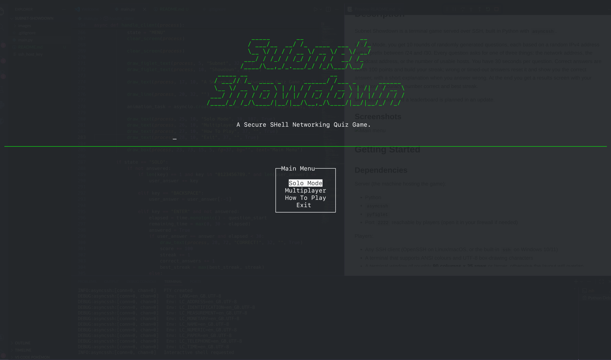
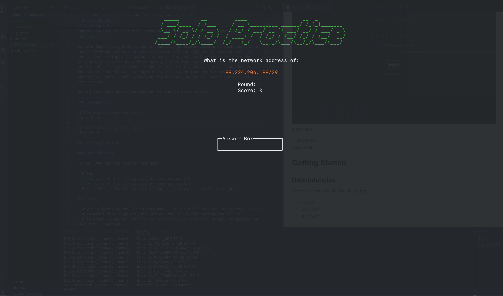

```
ssh -p 2222 subnetshowdown.tomttfb.com
```

# Subnet Showdown

A subnetting quiz game you play over SSH. Connect from any terminal to test how fast you can work out network addresses, broadcast addresses and usable host counts.

Made for Hack Club Crescent's SSH Card

## Description

Subnet Showdown is a terminal game served over SSH, built in Python with `asyncssh`.

In Solo Mode, you get 10 rounds of randomly generated questions, each based on a random IPv4 address with a prefix between /24 and /30. Every question asks for one of three things: the network address, the broadcast address, or the number of usable hosts. You have 30 seconds per question. Correct answers are worth 100 points and build your streak; wrong or timed-out answers reset it and show you the correct answer, with a short explanation when you answer wrong. At the end you get a results screen with your final score, accuracy, number correct and best streak.

Multiplayer mode and a leaderboard is planned in an update.

### Screenshots


*Main Menu*


*Solo Mode*

## Getting Started

### Dependencies

Server (the machine hosting the game):

- Python
- [`asyncssh`](https://pypi.org/project/asyncssh/)
- [`pyfiglet`](https://pypi.org/project/pyfiglet/)
- Port `2222` reachable by players (open it in your firewall if needed)

Players:

- Any SSH client (OpenSSH on Linux/macOS, or the built-in `ssh` on Windows 10/11)
- A terminal that supports ANSI colours and UTF-8 box-drawing characters
- A terminal window of roughly **90 columns x 35 rows** or larger, otherwise the layout will overlap

### Installing

Clone the repository:

```
git clone https://github.com/tomTTFB/subnet-showdown.git
cd subnet-showdown
```

Install the Python dependencies:

```
pip install asyncssh pyfiglet
```

No other changes are needed. On first run the server generates an host key and saves it as `ssh_host_key` in the directory. Make sure to keep this file private

### Executing program

Start the server:

```
python main.py
```

You should see `now listening on port 2222`.

Connect as any username:

```
ssh -p 2222 player@<server-ip>
```

Controls:

- **Up / Down arrows** to move through the menu
- **Enter** to select an option, submit an answer, or go to the next question
- **0-9 and `.`** to type your answer
- **Backspace** to delete
- **Esc** to return to the main menu

## Help

**"Host key verification failed" / "REMOTE HOST IDENTIFICATION HAS CHANGED"**
This happens if `ssh_host_key` was deleted and regenerated. Remove the old entry from your known hosts:

```
ssh-keygen -R "<server-ip>:2222"
```

**The screen looks broken or text overlaps**
Make your terminal window bigger (around 90x35 or more) and reconnect.

**Boxes and lines show as `?` or garbage characters**
Your terminal is not using UTF-8. Switch the terminal's encoding to UTF-8 or use a different terminal.

**Connection refused**
Check the server is running and that port 2222 is open on the host's firewall.

## License

MIT